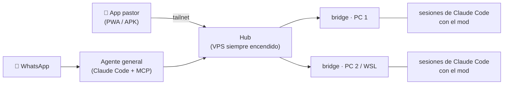

# pastor

**El centro de mando de tus agentes de Claude Code, en el bolsillo.**

pastor convierte todas tus sesiones de Claude Code, en todas tus máquinas, en un solo rebaño que ves y diriges desde el móvil. Es un mod nativo de Claude Code, un hub siempre encendido y una app (PWA y APK de Android). Trae además un agente propio que controla todo el hub y al que le escribes por WhatsApp.

No lee la terminal a través de tmux ni raspa la pantalla, como hacen otras herramientas (por ejemplo [Collie](https://github.com/AltanS/collie)). Se engancha a los eventos reales de cada sesión, así que lo que ves en el móvil es lo que Claude está haciendo:

- prompts y turnos;
- llamadas a herramientas y permisos;
- preguntas, subagentes y tareas en segundo plano.



## Qué puedes hacer

### Ver y ordenar tus sesiones
- **Panel de todas tus PCs**, agrupado por máquina, por proyecto o por reciente. Cada sesión muestra un estado en vivo:
  - trabajando;
  - te necesita;
  - esperando un shell o un subagente;
  - en reposo;
  - cerrada.
- **Las sesiones no saltan de sitio** cuando cambian de estado. Las ordenas tú arrastrándolas.
- **+ Nueva sesión:**
  - eliges la PC y uno de sus proyectos (con rama y conversaciones recientes) o cualquier carpeta;
  - opcionalmente continúas la última conversación.
- **Mission control:** todas las sesiones vivas en mosaico, para seguir varias a la vez.
- **Cerrar sesiones** desde el móvil (como `/exit`, deteniendo antes las tareas en segundo plano), o quitar de la lista las ya cerradas.

### Conversar con cada sesión
- **Chat en vivo:** el texto llega en streaming y verás:
  - las herramientas resumidas y su detalle;
  - el plan de tareas;
  - el uso de contexto;
  - el resumen de cada turno.
- **Escribir mientras trabaja**, de tres formas:
  - **enviar ahora**, que lo lee en el mismo turno;
  - **al terminar**, que lo deja en cola;
  - **interrumpir y enviar**.
- **Modo fuera:**
  - los permisos (Permitir/Denegar) y las preguntas de `AskUserQuestion` te llegan al móvil con botones;
  - sin respuesta en 30 min, o al volver a "aquí", se responden en la terminal.
- **Subagentes y tareas en segundo plano** en vivo:
  - de cada uno ves tipo, reloj, tokens, pasos y salida;
  - puedes leer su conversación, escribirles y detenerlos.
- **Comandos de la sesión:**
  - los slash commands (built-in, skills, plugins, MCP), `/config` y los servidores MCP;
  - el progreso de cada comando en vivo, también el de los que escribes en la PC.
- **Imágenes:** las lecturas de imágenes se ven al tocar, en pantalla completa.

### Herramientas del proyecto
- **Git:** rama, estado y diff por archivo; commit, pull, push y crear un PR desde el móvil.
- **Terminal:** ejecuta comandos en cualquier PC del hub, con salida en vivo y colores ANSI.
- **Explorador de archivos:**
  - estado de git y buscador difuso;
  - visor con resaltado, markdown e imágenes;
  - "Mencionar en el mensaje" (`@ruta`).
- **Web en desarrollo:**
  - abre en el móvil el `localhost:5173` (o el puerto que sea) de cualquier PC, a través de la tailnet;
  - funciona aunque el servidor solo acepte conexiones desde `localhost`: pastor reescribe `Host`, `Origin` y `Referer`.
- **Páginas HTML locales:**
  - cada `.html` que Claude escribe aparece con un botón "Ver archivo.html" y se abre renderizado en el móvil;
  - es como los artifacts, pero con archivos de tu disco.
- **Navegador en vivo:**
  - si una sesión usa [agent-browser](https://github.com/vercel-labs/agent-browser) o Playwright MCP, ves su navegador en vivo;
  - también puedes tocarlo, escribir y navegar.

### Rutinas programadas
- Prompts que se lanzan solos en el proyecto y la PC que elijas: a diario, ciertos días de la semana, cada N minutos o una sola vez.
- Ves el historial de cada ejecución y puedes abrir la sesión que generó.

### Agente general (opcional)
Un Claude Code que vive en el hub y controla todo pastor por MCP (`pastor-hub`, 21 herramientas):
- sesiones, prompts, permisos y rutinas;
- terminal, archivos y navegador.

Hablas con él de dos maneras:
- **WhatsApp:**
  - en mensajes directos al número del bot, solo desde los números que tú permitas;
  - cada número tiene su propia conversación.
- **La app:** un canal propio en la pantalla Agente.

Cómo se configura y se comporta:
- **Permisos:** configurables por grupo (sesiones, rutinas, terminal, archivos, WhatsApp). Por defecto, permiso total.
- **Vigilante:** configurable, por defecto todo apagado. Puede avisarte por WhatsApp:
  - si una sesión te necesita;
  - si termina o falla;
  - si una rutina corre o una PC se desconecta;
  - con un resumen diario.
- **No interfiere con el resto de pastor:** sus sesiones no salen en tu panel ni generan notificaciones; solo se ven desde la pantalla Agente.

### Una app con vida
- **Clawd camina por toda la app y reacciona a lo que pasa:**
  - por cada tarjeta de sesión, por el panel, la conversación, Mission control, el agente, las rutinas y la terminal;
  - trabaja, hace malabares, se alarma cuando te necesita y duerme cuando no hay nada;
  - celebra al terminar, se encoge si algo falla y se asoma cuando escribes.
- **Puedes tocarlo** para que salte, o lanzarlo para que rebote.
- **Otras mascotas:** Ferris, un patito, Zappy o Rocky. Clawd tiene disfraces, y hay tres niveles de animación: "Con vida", "Tranquilas" y "Quietas" (respeta "reducir movimiento").
- **PWA instalable y APK de Android:**
  - la APK trae notificaciones nativas;
  - se actualiza sola desde el hub.
  - También hay avisos opcionales por [ntfy](https://ntfy.sh).

## Instalar

**Requisitos:**
- Claude Code con soporte de mods;
- `node` 18+ en el PATH;
- [Tailscale](https://tailscale.com) (o Headscale) en tus PCs y en el móvil.

### 1. El mod, en cada PC

```
/plugin install pastor --marketplace S-kkipie/pastor
```

O a mano (Linux / macOS / WSL):
```sh
git clone https://github.com/S-kkipie/pastor ~/.claude/mods/pastor
node -e 'const f=require("os").homedir()+"/.claude/settings.json",fs=require("fs");let j={};try{j=JSON.parse(fs.readFileSync(f,"utf8"))}catch{};j.env={...j.env,CLAUDE_CODE_PLUGIN_DIRS:"~/.claude/mods/pastor"};fs.writeFileSync(f,JSON.stringify(j,null,2))'
```

Abre `claude`, escribe `/pastor serve` (publica el bridge en tu tailnet) y luego `/pastor`, que te da la URL y un código de emparejamiento. Abre la URL en el móvil, escribe el código y añádela a la pantalla de inicio.

### 2. El hub, en un servidor siempre encendido (recomendado)

Si el bridge vive en tu PC, al apagarla se cae todo. Con un hub en un VPS de tu tailnet:
- el móvil se empareja con el hub;
- el hub enlaza el bridge de cada PC;
- si una PC se apaga, sale como "sin conexión" y lo demás sigue funcionando.

```sh
git clone https://github.com/S-kkipie/pastor ~/pastor && sh ~/pastor/scripts/install-hub.sh
node ~/pastor/bridge/bridge.mjs link http://mi-pc.mi-tailnet/ 123456   # código de /pastor en esa PC
node ~/pastor/bridge/bridge.mjs status                                  # PCs, dispositivos y código para el móvil
```

El hub queda como servicio de systemd (`systemctl --user status pastor-hub`). Si además instalas Claude Code en el servidor, el hub también puede lanzar sesiones, rutinas y terminal allí.

### 3. El agente (opcional, en el hub)

Necesita Claude Code instalado en el servidor y un número de WhatsApp para el bot.
```sh
bash ~/pastor/scripts/install-agent.sh
```
Después, en la app:
1. Abre **Agente** y escanea el QR desde el WhatsApp del bot (Dispositivos vinculados).
2. Añade los números que pueden escribirle.

#### Con Hermes Agent en vez de Claude Code

[Hermes Agent](https://github.com/NousResearch/hermes-agent) puede ser el agente: su gateway atiende el WhatsApp del bot y el chat de la app, y controla el hub con el MCP `pastor-hub`. pastor-agent queda para la pantalla de la app y el vigilante.

1. Hermes en el hub, con su gateway como servicio (`hermes gateway install`) y WhatsApp vinculado al número del bot (`hermes whatsapp`). Un mismo número no puede estar vinculado a la vez en pastor-agent y en Hermes con las mismas credenciales.
2. En `~/.hermes/.env`: `API_SERVER_KEY=<openssl rand -hex 32>` (activa su `api_server` en `127.0.0.1:8642`) y `WHATSAPP_ALLOWED_USERS=<tus números>`.
3. En `~/.hermes/config.yaml`:
   ```yaml
   mcp_servers:
     pastor-hub:
       command: /usr/bin/node
       args: [/home/<tú>/pastor/agent/mcp/pastor-hub.mjs]
       env: { PASTOR_AGENT_HOME: /home/<tú>/pastor-agent, PASTOR_AGENT_CHANNEL: hermes }
       tools: { exclude: [whatsapp_send, whatsapp_send_me] }   # Hermes ya escribe por WhatsApp
   ```
4. Las instrucciones de pastor para Hermes: `cp ~/pastor/agent/templates/HERMES.md ~/.hermes.md` (el gateway trabaja en `$HOME`).
5. En `~/pastor-agent/config.json`: `"backend": "hermes"`, y `systemctl --user restart pastor-agent`.

En la app, **Agente** pasa a llamarse **Hermes**: el chat "App" habla con Hermes y sus chats de WhatsApp se leen ahí mismo. Activo hace `hermes pause` / `hermes resume`; el vigilante escribe con `hermes send`. Los números y el vínculo de WhatsApp se cambian en Hermes.

##### Monitores: avisar a Hermes cuando una sesión termina su turno

pastor ya avisa al **móvil** cuando cualquier sesión termina (notificaciones). Un **monitor** es distinto y opt-in: le dice a **Hermes** que vigile *una* sesión concreta, para que reaccione cuando esa sesión termine un turno (leerla, seguirle el hilo, avisarte). Las sesiones que no agregues no generan ningún aviso por este canal.

Cómo funciona, sin gasto de tokens del lado de la sesión:

- El **hub** ya detecta el fin de turno real de cada sesión (Claude en reposo y sin subagentes trabajando), en todas las PCs. No hay un hook nuevo en cada sesión ni se toca Claude Code.
- El hub guarda una lista de sesiones monitoreadas (`conf.monitors`) y, solo cuando hay alguna, mira esos fines de turno. Si la sesión está en la lista, hace un **POST firmado (HMAC) al webhook de Hermes**; si no está, no hace nada.
- Hermes recibe el evento en una ruta webhook propia y actúa (o no). Es su mecanismo nativo de activación por eventos: firmado, con anti-replay e idempotencia.

**Puesta en marcha (una vez, en el hub):**

```sh
bash ~/pastor/scripts/hermes-monitors-setup.sh
```

Crea la ruta `pastor-session` en Hermes (firmada) y apunta el hub a `http://127.0.0.1:8644/webhooks/pastor-session`. Si la plataforma webhook de Hermes no estaba activa, el script te dice el bloque que falta en `~/.hermes/config.yaml` (bajo `platforms:`) y que reinicies el gateway. Para comprobarlo o rehacerlo: `node ~/pastor/bridge/bridge.mjs monitors` (y `… hermes-hook <url> <secret>` para reapuntarlo).

**Poner y quitar un monitor, desde Hermes** (tools del MCP `pastor-hub`, úsalas en lenguaje natural: «vigila la sesión X», «deja de vigilar X»):

| Tool | Qué hace |
| --- | --- |
| `monitor_add { id, note? }` | Empieza a vigilar la sesión (el `id` es el de `sessions_list`). |
| `monitor_remove { id }` | Deja de vigilarla. |
| `monitors_list {}` | Las que vigila ahora. |

El aviso que recibe Hermes trae `event_type: session.turn_end` y los campos `session`, `title`, `machine`, `summary`.

### 4. La APK (opcional)

```sh
cd app && npm install && node ../scripts/build-apk.mjs   # necesita Android SDK + JDK 17
```
Deja `bridge/pastor.apk` en el hub. El móvil la descarga desde `/pastor.apk`, y la app avisa cuando hay una versión nueva.

**Actualizar:** `git pull` en cada máquina y reinicia las sesiones de Claude Code. El bridge se reemplaza solo al detectar una versión nueva.

## Comandos

| Comando | Qué hace |
| --- | --- |
| `/pastor` | URL, código de emparejamiento y estado |
| `/pastor away` · `/pastor here` | Modo fuera (responder en el móvil) · volver a la terminal |
| `/pastor serve` · `/pastor stop` | Publica el bridge con `tailscale serve` · lo detiene |
| `/pastor link <url> <código>` | Enlaza otra PC a este hub |
| `/pastor unlink <pc>` · `/pastor peers` | Quita una PC enlazada · lista las enlazadas |

La configuración vive en `~/.claude/pastor/config.json`: puerto, dispositivos emparejados, `ntfyTopic` y `publicUrl`. Para revocar un dispositivo, borra su entrada en `devices`. La del agente vive en `~/pastor-agent/config.json`.

## Seguridad

pastor da **control remoto de tus PCs por diseño**: un dispositivo emparejado puede mandar prompts, aprobar comandos, abrir una terminal y leer archivos con tus permisos.

- El bridge solo escucha en `127.0.0.1`.
- Cada dispositivo se empareja con un código de un solo uso y recibe su propio token.
- Publícalo solo dentro de tu tailnet, **nunca** con `tailscale funnel`.
- El agente arranca con permiso total: cualquiera que pueda escribirle desde un número permitido controla tu hub. Ajusta sus permisos en la app si lo compartes.

## Cómo está hecho

| Parte | Qué es |
| --- | --- |
| `hooks/register.ts` | El mod: hooks de sesión, turnos, herramientas, permisos y cierre |
| `bridge/bridge.mjs` | Servidor Node sin dependencias, compartido por todas las sesiones de una máquina. Hace de hub, proxy de previsualizaciones, navegador en vivo (CDP) y motor de rutinas |
| `app/` | React 19 + Vite + Tailwind v4 + motion, con Capacitor para la APK. `npm run build` compila a `bridge/web/` |
| `agent/` | El agente general: WhatsApp con [Baileys](https://github.com/WhiskeySockets/Baileys), un Claude Code por canal y el servidor MCP `pastor-hub` |
| `scripts/` | Instalación del hub y del agente, y construcción de la APK |

**Tests:**
- el mod: `claude plugin test .`
- el agente: `cd agent && npm test`

## Créditos

- **Clawd:**
  - sprites de [glowup](https://github.com/NovusEdge/glowup), de Aliasgar Khimani (MIT);
  - poses de [clawd-pet](https://github.com/abderrahimghazali/clawd-pet), de Abderrahim Ghazali (MIT).
- **Ferris, patito, Zappy y Rocky:** de [vscode-pets](https://github.com/tonybaloney/vscode-pets), con arte de Marc Duiker (MIT).
- **Orbe:** [thinking-orbs](https://github.com/Jakubantalik/thinking-orbs), de Jakub Antalik (MIT).
- **Inspiración:** [Collie](https://github.com/AltanS/collie).

Las licencias de cada recurso están junto a sus archivos. pastor se publica bajo [MIT](LICENSE).
